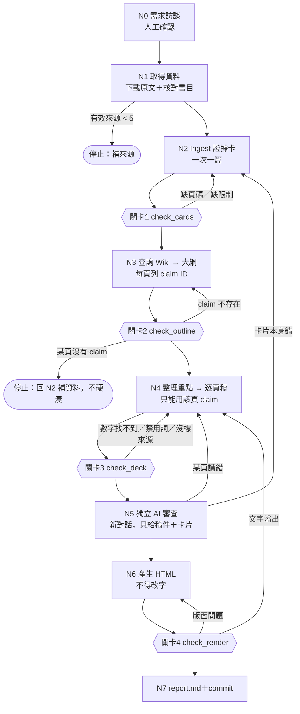

# 第十週作業完整執行指南（v2：已對齊你 N0 確認的需求）
## English Mastery：用學習科學準備多益 L&R

> 繳交期限：**11/23（一）23:59**；遲交期限：11/24 16:00
> 這份工具包提供：流程設計、每個節點的 prompt、模板、已查證的書目、4 支已測試的檢查腳本。
> **v2 變更**：依你的 requirements.md 改為「聽力優先」「每階段都檢查（Q9）」「少量互動（Q8）」；來源 ID 改成和你的 sources.md 一致；腳本支援 `AI-xx` 教學建議與「只有摘要」的來源。
> **衝突時以你的 requirements.md 和 AGENTS.md 為準。**
> **不提供**：Wiki 內容、AGENTS.md 成品、簡報成品、執行紀錄、反思答案。這些必須由你實際執行產生，否則違反「先討論、後生成」，也可能構成抄襲。

---

## 0. 評分規準對照：每一項要靠什麼拿分

| 9～10 分條件 | 你要交出的證據 | 本工具包哪裡幫你 |
|---|---|---|
| Wiki 資料與簡報內容有明確對應 | `mapping.md`（頁 ↔ claim ID 對照表）＋簡報每頁標註來源 | `check_deck.py` 自動產生 |
| loop／graph 設計合理且說明清楚 | 流程圖＋每個節點的輸入、輸出、檢查、退回規則 | 第 3 節 |
| 有實際執行與檢查紀錄 | `report.md`＋各關卡輸出＋截圖＋git log | 4 支腳本＋`templates/report.md` |
| 反思易錯節點與如何提前檢查 | 根據兩輪實際結果的比較 | 第 5 節的做法 |
| 簡報有清楚的教學結構 | 由淺入深的大綱 | 第 4 節 |

---

## 1. 主題定位（寫進繳交內容第 1 項）

- **Wiki 主題**：英語學習科學與多益 L&R 備考
- **簡報標題**：English Mastery——用學習科學準備多益 L&R
- **讀者**：對多益和學習科學都不熟的大學生（作業要求：原本不熟悉主題的人能理解基本概念）
- **範圍**：只做 Listening & Reading。不做 Speaking & Writing、不做解題技巧、不給分數保證
- **教學主軸**：考試要求 → 研究支持的練習方法 → 這個證據的邊界

---

## 2. 時程（今晚到明晚）

| 時段 | 工作 | 產出 | commit 訊息 |
|---|---|---|---|
| ✅ 已完成 | N0 訪談、requirements.md、AGENTS.md | — | — |
| 今晚 23:00–00:30 | N1 收尾：下載 S1 快照和 S2–S5 全文；查圖書館能不能取得 S6 | `raw/`、更新 `sources.md` | `n1: sources verified` |
| 明早 09:00–11:30 | N2 分組 ingest：官方組（S1）→ 學習科學組（S2、S3）→ L2 組（S4–S6），每組跑 `check_cards.py` | `wiki/sources/S*.md`、`wiki/concepts/` | 每組一個 commit |
| 明午 11:30–14:00 | N3 大綱 → 關卡 2 → N4 逐頁稿 → 關卡 3（失敗就局部修正） | `runs/round1/` | 每次修正一個 commit |
| 明午 14:00–15:30 | N5 獨立審查（新對話）→ 退回修正 → 依第 5 節把檢查前移 | `review.md`、修改過的腳本或 prompt | `move check upstream: …` |
| 明午 15:30–17:00 | N6 HTML（含理解題）→ 關卡 4 | `deck.html`、截圖 | `render` |
| 明晚 17:00–19:00 | 部署 HTML（GitHub Pages）→ 用無痕視窗實測 | 連結 | `deploy` |
| 明晚 19:00–21:00 | 寫流程說明和反思（自己的話）、整理繳交內容 | 繳交文字 | — |
| 21:00–23:59 | 緩衝 | — | — |

**如果時間不夠**（需求 R10：準時優先），優先順序是：可瀏覽的 HTML > Wiki 對應 > 一輪完整執行紀錄 > 反思 > 理解題 > 頁數。可以先刪理解題和頁數，**不能刪檢查**。

---

## 3. Graph／Loop 設計

### 3.1 流程圖（可直接貼到支援 Mermaid 的地方）



> 依你在 Q9 的決定，**每個關卡從第 1 輪就全部開啟**，不刻意關掉早期檢查。「把檢查往前移」的反思材料來自第 5 節的做法。

### 3.2 節點規格

| 節點 | 輸入 | 輸出 | 完成標準 | 檢查 | 失敗退回 | 重試上限 |
|---|---|---|---|---|---|---|
| N0 需求訪談 | 開場 prompt | interview-log.md、requirements.md、AGENTS.md | 需求摘要每一條都寫進 AGENTS.md | 人工逐條對照 | N0 | — |
| N1 取得資料 | sources.md 書目 | raw/ 原文 | 每篇題名、作者、年份和原文封面一致 | 人工 | 換來源 | — |
| N2 Ingest | 一篇原文 | wiki/sources/Sx.md | 關卡 1 通過 | `check_cards.py` | N2（只重做那一篇） | 2 輪 |
| N3 大綱 | wiki/ | outline.md | 每頁有 claim、每篇來源都被用到 | `check_outline.py` | 缺資料就停止 | 2 輪 |
| N4 逐頁稿 | outline＋對應卡片 | drafts.html | 關卡 3 通過 | `check_deck.py` | 只重寫失敗的那頁 | 2 輪 |
| N5 AI 審查 | 稿件＋卡片 | review.md | 沒有講反、沒有因果誤植 | 新對話 AI | N4 或 N2 | 1 輪 |
| N6 渲染 | 已通過的稿件 | deck.html | 文字和稿件相同、不溢出 | `check_render.py` | N4 或 N6 | 2 輪 |
| 全流程 | — | — | — | — | — | **最多 3 輪，超過就停下交給人工**（講義 p.23） |

### 3.3 為什麼這樣設計（寫說明時可參考，請用自己的話）
- **證據卡一次一篇**：避免不同研究的結論混在一起（講義 p.44）。
- **大綱階段就檢查 claim 對應**：如果等到 HTML 才發現某頁沒有來源，就要從最後一關退回起點，也就是大圈（講義 p.26）。
- **數字比對交給程式，語意判斷交給獨立 AI**：程式能可靠地檢查「60 分鐘這個數字在不在卡片裡」，但檢查不出「結論講反了」（講義 p.22）。
- **渲染節點不准改字**：避免排版時順手改掉已經檢查過的內容（講義 p.44）。
- **找不到資料就停**：不要用 AI 自己的知識硬湊（講義 p.23）。

---

## 4. 建議教學大綱（12 頁，聽力優先，含 3 題理解題）

| 頁 | 標題 | 教學目標 | 來源 | 注意 |
|---|---|---|---|---|
| 1 | English Mastery | 封面＋「這份簡報不保證分數」 | — | `data-type="title"` |
| 2 | 多益 L&R 長什麼樣子 | 題數、時間、7 個 Part | S1 | 時間的寫法要標示依據 |
| 3 | 聽力和閱讀各考什麼 | 連結考試和能力 | S1 | 只用官方描述 |
| 4 | 為什麼「重讀、畫重點」不夠 | 修正常見習慣 | S2 | 原文是「低效用評等」，不是「沒用」 |
| 5 | 聽力①：精聽和泛聽是什麼 | 兩種練法的定義 | S6 | 如果只有摘要，只寫摘要有的內容 |
| 6 | 聽力②：研究發現與限制＋理解題 1 | 讀懂研究結果 | S6 | 沒有對照組；不能說泛聽無效 |
| 7 | 閱讀：讀大量、讀得懂的英文＋理解題 2 | 大量閱讀 | S5 | 長期效果大多沒有測試 |
| 8 | 單字①：分散在不同天複習 | 間隔練習 | S3、S2 | S3 是一般記憶研究；不給最佳天數 |
| 9 | 單字②：考自己、複習舊字＋理解題 3 | 累積測驗 | S4 | 效果取決於練習量和程度，照原文寫 |
| 10 | 研究能說什麼、不能說什麼 | 證據素養 | 全部 | 這些研究都不是多益分數的直接證據 |
| 11 | 入門備考規劃範例 | 回應需求 R02 | AI-01…（concepts/） | 頁面必須寫「AI 建議／教學示例」，腳本會檢查 |
| 12 | 參考資料 | 可追溯 | 全部 | `data-type="refs"` |

**理解題的規則**：題目、選項和解答都必須來自該頁的 claim，也要掛在同一個 `data-claims` 下（腳本會連隱藏的解答一起檢查數字和禁用詞）。互動只用原生 JavaScript，`check_render.py` 會回報 JavaScript 錯誤。

## 5. 反思怎麼產生（每階段都檢查的版本）

每個關卡從一開始就全部開啟，所以「把檢查往前移」的意思是：**某個錯誤被比較下游的關卡抓到，你就在更上游的關卡新增一條規則，讓它下次更早被抓到。** 例如：
- N5 獨立審查發現某頁把相關寫成因果 → 在 `banned.txt` 加入那個說法（移到關卡 3），或在 ingest prompt 要求卡片寫明研究設計（移到 N2）。
- 渲染時才發現某頁太長 → 在逐頁稿 prompt 加上字數上限（移到 N4）。
- 大綱階段才發現某篇卡片沒有限制欄位 → 這條 `check_cards.py` 已經有；如果沒擋下，就檢查腳本為什麼漏掉。

做法：
1. 每個關卡的 FAIL 都記進 `report.md`，註明**是哪一關抓到的**，以及**它最早其實可以在哪一關被抓到**。
2. 「被下游抓到、但其實上游就能抓」的錯誤，就是要前移的檢查。實際修改腳本、prompt 或 banned.txt，然後 commit（commit 訊息寫清楚原因）。
3. 修改後重跑受影響的節點，記錄結果是否不同。
4. 如果整輪都沒有錯誤是被下游才抓到的，就照實寫，並說明你判斷哪個節點**最可能**出錯、理由是什麼。**不要為了反思而編造錯誤。**

## 6. 繳交前檢查清單

- [ ] 標題：`學校 學號 系級 姓名 English Mastery`
- [ ] 1. Wiki 主題與簡短介紹
- [ ] 2. Wiki 連結：GitHub repo，**raw/ 不公開**（已列在 .gitignore）
- [ ] 3. HTML 簡報連結：已用無痕視窗和手機實測
- [ ] 4. 流程圖（Mermaid 或截圖）＋文字說明（3.2、3.3）
- [ ] 5. 執行紀錄：`report.md`、各關卡輸出、`mapping.md`、截圖、git log
- [ ] 6. 反思：用自己的話寫，以實際數據為依據
- [ ] 註明哪些內容由 AI 生成、你如何檢查
- [ ] **個資**：公開 repo 裡的 `interview-log.md` 要刪掉個人背景（例如考試分數），改成「［個人背景，已省略］」；完整版留在本機（AGENTS.md 已規定不公開個資）
- [ ] interview-log.md 是根據對話整理的版本；如果能附上原始對話的分享連結，證據更強

---

## 7. 檔案結構

```text
english-mastery/
├── AGENTS.md            ← 訪談後由 AI 生成（見 prompts/01）
├── interview-log.md     ← 訪談原文
├── requirements.md      ← 需求摘要
├── sources.md           ← 已查證書目（本工具包提供）
├── raw/                 ← 原文 PDF（不上傳）
├── wiki/
│   ├── index.md
│   ├── log.md
│   ├── sources/S1.md …  ← 證據卡（依來源）
│   └── concepts/        ← 主題整合頁、AI-ADVICE
├── runs/round1/ round2/ ← outline.md、drafts.html、deck.html、mapping.md、review.md、report.md、screenshots/
├── scripts/             ← 4 支檢查腳本＋banned.txt
└── docs/index.html      ← 最終簡報（GitHub Pages 用）
```

**先在你的電腦上跑自我測試**（確認腳本在你的環境能正常運作）：

```bash
python selftest/run_selftest.py      # 應該顯示「全部符合預期」
```

腳本用法：

```bash
python scripts/check_cards.py wiki/sources
python scripts/check_outline.py runs/round2/outline.md wiki/sources
python scripts/check_deck.py runs/round2/deck.html wiki/sources scripts/banned.txt
pip install playwright && playwright install chromium   # 只需一次
python scripts/check_render.py runs/round2/deck.html --links
```

腳本限制（寫反思時可以提）：
- 數字檢查只看兩位數以上、小數和百分比，單一位數會略過。
- 禁用詞只做字面比對，換句話說就抓不到。
- 腳本無法判斷語意，這部分要靠 N5 的獨立審查。
