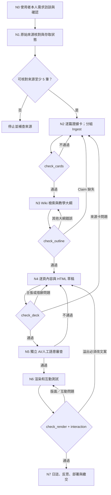

# English Mastery｜實際 Graph／Loop 工作規格

## 控制圖

## 本次實際可證明的關卡

- N0：本人逐題訪談與摘要確認已完成。
- N1：已從網路檢視官方與出版商內容（S1–S8），但原文 raw/ 下載檔並未全部在此環境取得；S6 限出版社摘要。
- N2：八份來源證據卡（19 條來源 Claim）及兩條 AI-ADVICE，`check_cards.py` PASS。
- N3：十二頁大綱，`check_outline.py` PASS。
- N4：HTML 草稿由 Wiki Claims 對應產生，`check_deck.py` 經局部修正 PASS。
- N5：已做本輪內部事實對照，但**尚未完成獨立新對話審查**，不得寫成已完成。
- N6：`check_render.py` 在受限 set_content 模式未檢出溢出，互動測試經修正通過；**非正式公開部署測試**。
- N7：本執行環境已保存報告與成果，但未部署公開站點。

## Loop 設計與停止條件

- 每個節點輸出立即檢查，符合需求訪談 Q9；不會刻意略過第一輪檢查。
- 每節點最多 2 次局部修正，全流程最多 3 輪；超過停止、列出人工待決事項。
- 若少於 5 個可追溯來源、缺乏關鍵證據、S6 全文無授權取得，不以 AI 推測補足。
- 格式、來源 ID、數字、禁用詞與溢出交由程式；學術解讀與研究外推交由不同審查者。
- 反思所說的「檢查前移」必須基於真實錯誤。此次遇到 HTML 草稿的禁用詞、裝飾性數字、鍵盤焦點問題；Round 2 審查另找出缺乏精聽／泛聽定義、未被腳本抓到的 CSS 視覺誤導，以及手機控制項重疊；可在 N4 草稿層加入預檢，並保留 N6 互動功能測試。

## Round 2 增設的上游與跨頁檢查

- **定義缺乏證據**：外部審查發現 P4 雖有 S6 的效果摘要，卻缺兩種聽力練習的基本定義。因此退回 N1/N2 增加公開教學來源 S8，於 N3 引用後重寫 N4。後續把「術語教學定義可追溯」列為大綱驗收條件。
- **視覺誤導**：原先 P7 透過 CSS 寫死 85%／27% 寬度，文案數字檢查抓不到。N4/N6 新增視覺項目：「長條／面積／百分比是否有數據來源」；實際以定性標籤替換。
- **控制項重疊**：原始 `check_render.py` 只能測投影片內溢出，不能證明固定導覽列不遮住頁尾。新增 `tests/viewport_review_round2.py` 量測筆電與手機的 `footer` 和 `controls` 矩形。手機第一次 FAIL、修正後 PASS；紀錄見 Round 2 報告。
